<div align="center">


# StudyLens

**Turn study material, specs and WBS spreadsheets into notebooks you actually read — on your Mac or PC.**

Drop in slides, PDFs, Word, PowerPoint or Excel, press **Process**, and Claude Code writes one self-contained, interactive HTML notebook.
Every line explained, every spec analysed, every WBS mapped — and every number checked by the app, not trusted from the AI.

<p>
  
  
  
  
  
</p>

<p>
  <a href="https://github.com/haonguyenstech/studylens/releases/latest/download/StudyLens-mac-arm64.dmg"></a>
  &nbsp;
  <a href="https://github.com/haonguyenstech/studylens/releases/latest/download/StudyLens-Setup-win-x64.exe"></a>
</p>
<sub>macOS button is for Apple silicon (M1 or later) · <a href="https://github.com/haonguyenstech/studylens/releases/latest/download/StudyLens-mac-x64.dmg">Intel Mac</a> · <a href="https://github.com/haonguyenstech/studylens/releases/latest">all downloads</a></sub>

<br /><br />

<a href="#features">Features</a> ·
<a href="#getting-started">Getting started</a> ·
<a href="#guide">Guide</a> ·
<a href="#how-it-works">How it works</a> ·
<a href="#safety">Safety</a> ·
<a href="#releases-and-self-update">Releases</a> ·
<a href="#project-layout">Project layout</a>

<br /><br />

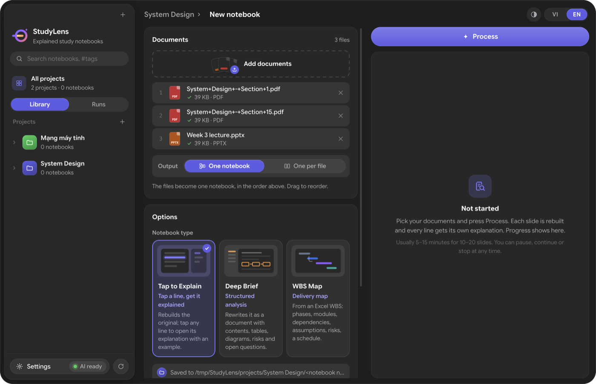

</div>

---

## Features

### 📚 Three notebook types
| | |
|---|---|
| **Tap to Explain** | Rebuilds the original slides; tap any line — or any box and arrow in a diagram — to open a drawer: a plain-language take, an everyday analogy, where it shows up in apps you use, and the deep technical version. |
| **Deep Brief** | Rewrites a long document (RFP, PRD, spec, course) as a structured analysis: contents rail, key facts, parts and numbered sections, tables, Mermaid diagrams drawn to SVG, contradictions, glossary and open questions. |
| **WBS Map** | Reads a work breakdown structure in Excel and builds a delivery map: effort by phase and role, a dependency map between modules, the end-to-end flow, an editable schedule, and per phase/module its purpose, cohesion, preconditions, assumptions and risks — plus findings, WBS quality checks, estimate confidence and the critical chain. |

<table>
  <tr>
    <td>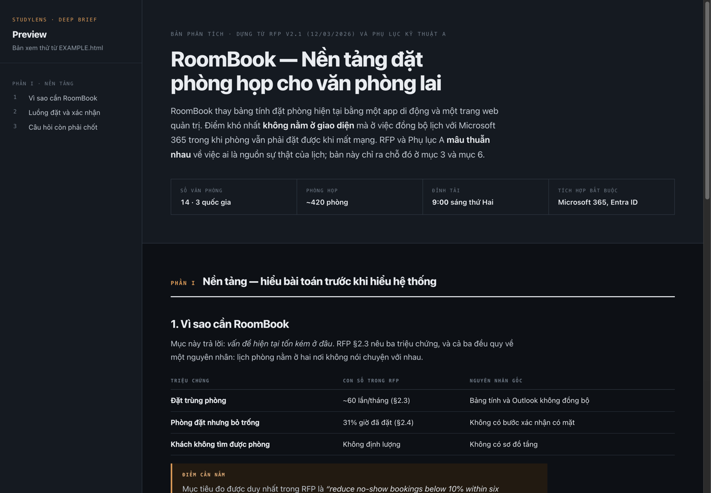</td>
    <td>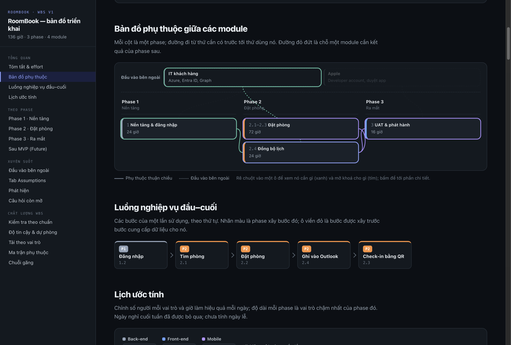</td>
  </tr>
  <tr>
    <td align="center"><sub>Deep Brief</sub></td>
    <td align="center"><sub>WBS Map — hover a module to see what it needs and unlocks</sub></td>
  </tr>
</table>

### 🗂️ Projects & library
- **Projects are folders** on disk; notebooks made in a project are saved inside it, one folder each (`<project>/<name>/<name>.html`).
- Rename, move (drag onto a project), take out, delete — the files follow.
- **Tags** on notebooks, with ready-made suggestions; search by `#tag`, by title or by source file name, accents optional.

### ▶️ Runs you can pause
- One notebook from many files, or one per file.
- **Pause, stop, continue** — even after quitting the app: the same Claude session resumes in the same folder.
- Retry a file, skip it, retry the failed ones, start over; a live log per file.

### 👀 Quick look
Preview a notebook — or its source PDFs and images — inside the app (<kbd>Space</kbd> on a card). Notebooks run sandboxed on their own origin; links open in your browser.

### 🎨 Made to be lived in
Light, dark or follow the system · Vietnamese and English UI · Google Sans Flex · an animated logo · updates itself from GitHub Releases.

<p align="center">
  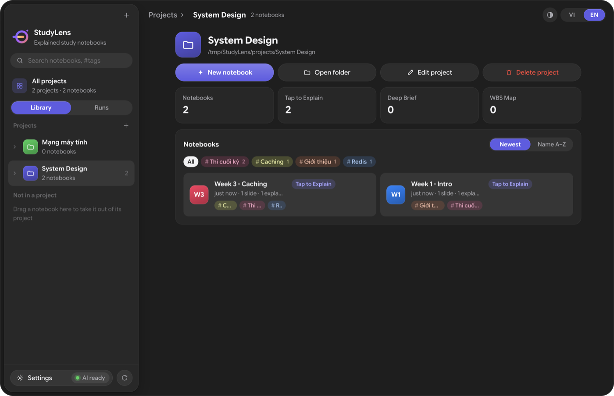
  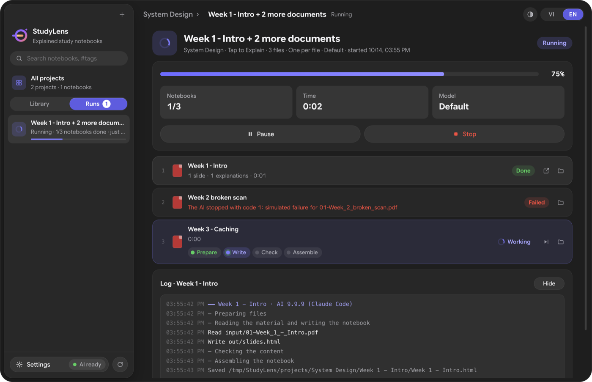
</p>

---

## Getting started

### Requirements
- macOS 11+ (Apple silicon or Intel) or Windows 10+
- [Claude Code](https://claude.com/claude-code) installed and logged in once (run `claude` in a terminal). StudyLens runs `claude -p` headless on your existing plan — **no API key**.

StudyLens finds `claude` on its own. If it can't, open **Settings → AI engine** and enter the path:
`~/.local/bin/claude` on macOS, `%USERPROFILE%\.local\bin\claude.exe` (or `%APPDATA%\npm\claude.cmd`) on Windows.

### Install
Use the download buttons at the top, or pick a file from the **[latest release](https://github.com/haonguyenstech/studylens/releases/latest)**:

| | |
|---|---|
| macOS, Apple silicon | [StudyLens-mac-arm64.dmg](https://github.com/haonguyenstech/studylens/releases/latest/download/StudyLens-mac-arm64.dmg) |
| macOS, Intel | [StudyLens-mac-x64.dmg](https://github.com/haonguyenstech/studylens/releases/latest/download/StudyLens-mac-x64.dmg) |
| Windows 10/11 (x64) | [StudyLens-Setup-win-x64.exe](https://github.com/haonguyenstech/studylens/releases/latest/download/StudyLens-Setup-win-x64.exe) |

The app is not code-signed. On macOS, the first time: right-click the app → **Open** (or run `xattr -cr /Applications/StudyLens.app`). On Windows, SmartScreen may warn: **More info → Run anyway**. After that, StudyLens updates itself.

### Build & run

```bash
npm install
npm run dev          # hot reload: CSS swaps in place, renderer reloads, main/preload restart. F12 = DevTools
npm run app          # build + pack this Mac's .app + install to /Applications (~5 s)
npm test             # library, Deep Brief, WBS, run engine (fake Claude) and diagram tests
npm run release      # every installer, uploaded to this repo's GitHub Releases (see below)
```

The Guide's screenshots come from the app itself, with demo data and a fake Claude:

```bash
STUDYLENS_GUIDE=1 STUDYLENS_THEME=dark STUDYLENS_FAKE_CLAUDE=$PWD/scripts/fake-claude.mjs STUDYLENS_SHOOT=/tmp/StudyLens npx electron .
```

Without the UI:

```bash
node scripts/run-cli.mjs file.pdf --model sonnet --fast --out /tmp/out           # Tap to Explain
npx electron scripts/run-cli-electron.cjs spec.pdf --brief --out /tmp/out         # Deep Brief (draws diagrams)
npx electron scripts/run-cli-electron.cjs wbs.xlsx --wbs --out /tmp/out           # WBS Map
```

## Guide

The numbers in each screenshot match the table under it.

### 1. Check the AI engine

Open **Settings** (bottom left). The pill next to it says **AI ready** once Claude Code is found.

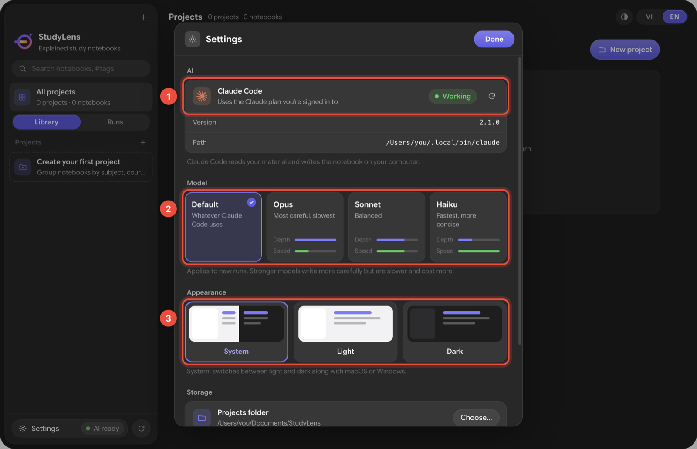

| | |
|---|---|
| **1 · Claude Code** | **Working** means StudyLens found `claude` and it answered. Not found? Click the refresh icon after installing it, or enter its path here. |
| **2 · Model** | **Default** uses whatever Claude Code uses. Opus writes most carefully and is slowest; Haiku is fastest. Applies to new runs. |
| **3 · Appearance** | Light, dark, or follow the system. The ◐ button in the header switches it too. |

> 📌 Further down: **Projects folder** (where new projects go, `~/Documents/StudyLens` by default) and **Updates**.

### 2. Make a project

A project is a folder on disk; every notebook made in it gets its own folder inside. Click **+** next to *Projects* in the sidebar, or **New project** on the home page.

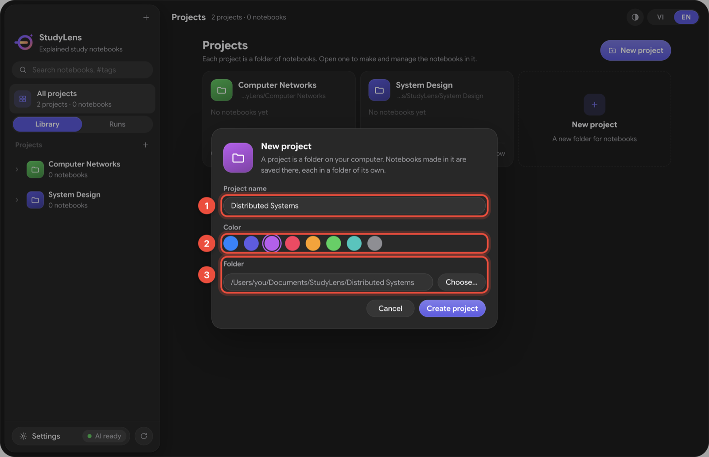

| | |
|---|---|
| **1 · Project name** | Also the folder name. |
| **2 · Color** | Tints the project's icon in the sidebar. |
| **3 · Folder** | Where the folder is created. **Choose…** to put it anywhere, e.g. a synced drive. |

> 📌 Renaming a project renames its folder. Drag a notebook onto another project to move it, files and all.

### 3. Add documents and press Process

Open the project → **New notebook**.

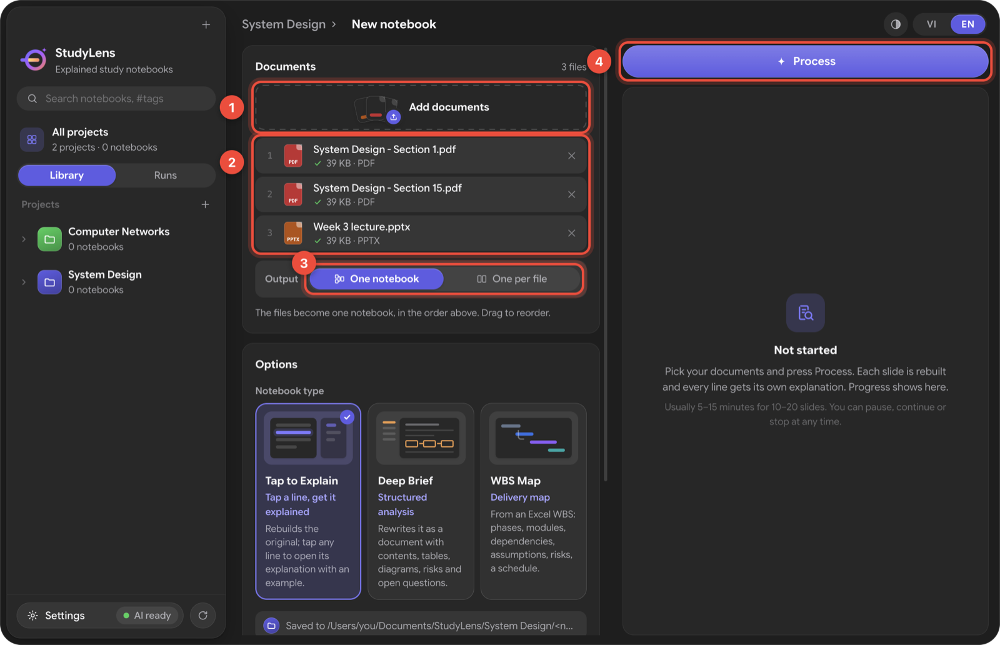

| | |
|---|---|
| **1 · Add documents** | Click to pick files, or drop them here: PDF, PPTX, DOCX, XLSX, images. |
| **2 · Files** | The order the notebook follows. Drag to reorder, ✕ to remove. A ✓ means the file was found and is readable. |
| **3 · Output** | **One notebook** from all the files, or **One per file** (a separate notebook for each, run one after another). |
| **4 · Process** | Starts the run. Disabled until Claude Code is ready and the files fit the notebook type. |

Then scroll down to the options:

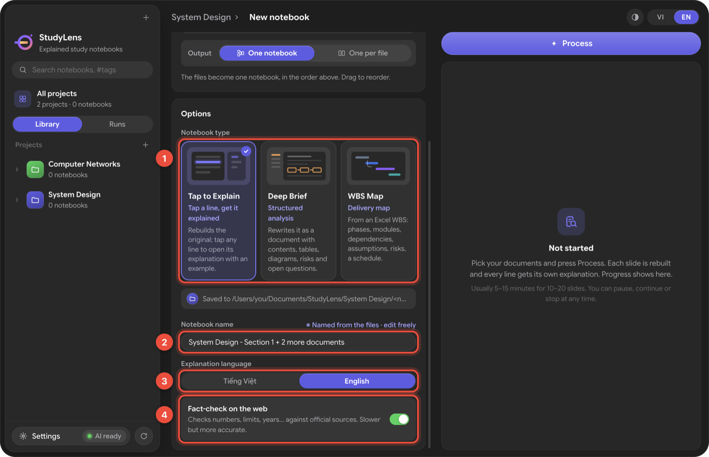

| | |
|---|---|
| **1 · Notebook type** | **Tap to Explain** for slides and lectures, **Deep Brief** for long documents (RFP, PRD, spec), **WBS Map** for an Excel WBS. |
| **2 · Notebook name** | Filled in from the files; type over it. With *One per file* each notebook gets its own name. |
| **3 · Explanation language** | The language the notebook is written in, whatever the documents are in. |
| **4 · Fact-check on the web** | Lets Claude check numbers, limits and years against official sources. Slower, more accurate. |

**WBS Map** reads figures straight from the workbook, so it needs at least one `.xlsx`:

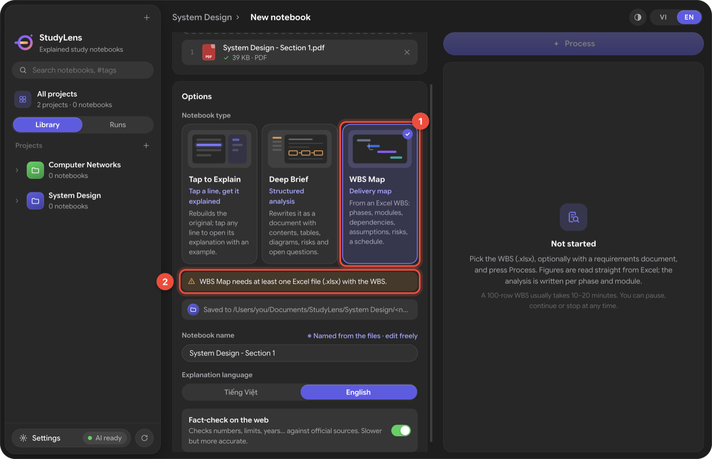

| | |
|---|---|
| **1 · WBS Map** | Add the WBS workbook, plus the RFP / PRD if you have one (used to trace requirements). |
| **2 · Warning** | Shown, and Process stays off, until an `.xlsx` is in the list. |

> 📌 Hidden sheets in the workbook are skipped: they are usually old drafts.

### 4. Follow the run

The run page opens by itself. Runs keep going while you use the rest of the app; the **Runs** tab in the sidebar lists them.

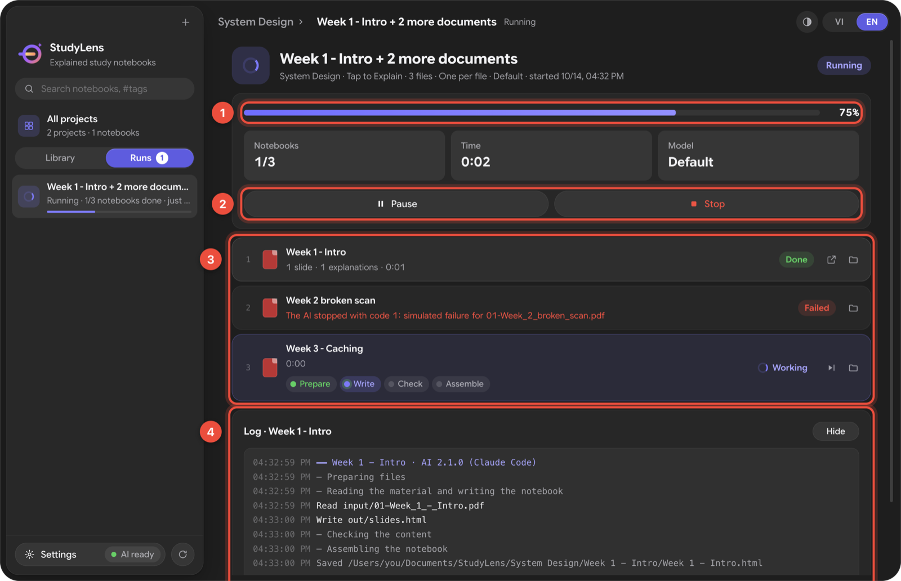

| | |
|---|---|
| **1 · Progress** | Across all notebooks of the run, with time so far and the model. |
| **2 · Pause / Stop** | **Pause** keeps the Claude session; **Continue** picks up where it left off — even after you quit the app. |
| **3 · Notebooks** | One row per notebook with its steps: *Prepare → Write → Check → Assemble*. Click a row to see its log. |
| **4 · Log** | What Claude is reading and writing, and what the app checked. |

When a notebook fails, the others still finish:

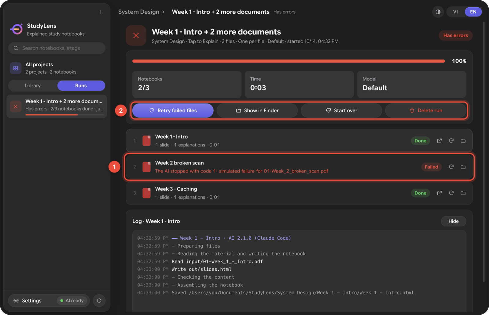

| | |
|---|---|
| **1 · Failed notebook** | The reason is under its name. ↻ retries just this one. |
| **2 · Run controls** | **Retry failed files**, show the result in Finder / Explorer, **Start over**, or delete the run. |

> 📌 A usage-limit error is the most common failure. Wait for your plan to reset, then **Retry failed files**.

### 5. Open a notebook

Notebooks appear on the project page.

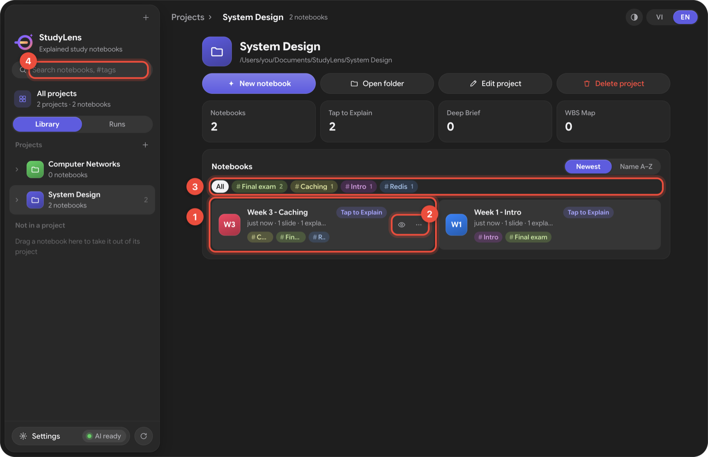

| | |
|---|---|
| **1 · Notebook card** | Click for details; <kbd>Space</kbd> opens a quick look. Drag it onto another project to move it. |
| **2 · Quick look · ⋯** | The eye opens the quick look; **⋯** has rename, tags, move to a project, view the run, delete. |
| **3 · Tag filter** | Show only the notebooks with a tag. |
| **4 · Search** | Searches every project: titles, source file names and `#tags`. |

**Quick look** shows the notebook — or one of its source files — inside the app:

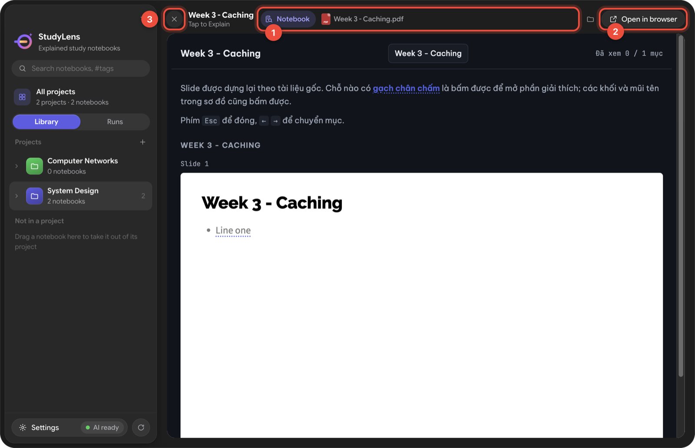

| | |
|---|---|
| **1 · Tabs** | The notebook, then each source document (PDFs and images show in place). |
| **2 · Open in browser** | The notebook is one `.html` file: open it in any browser, share it, it works offline. |
| **3 · Close** | Or <kbd>Esc</kbd>. |

The notebook's own page:

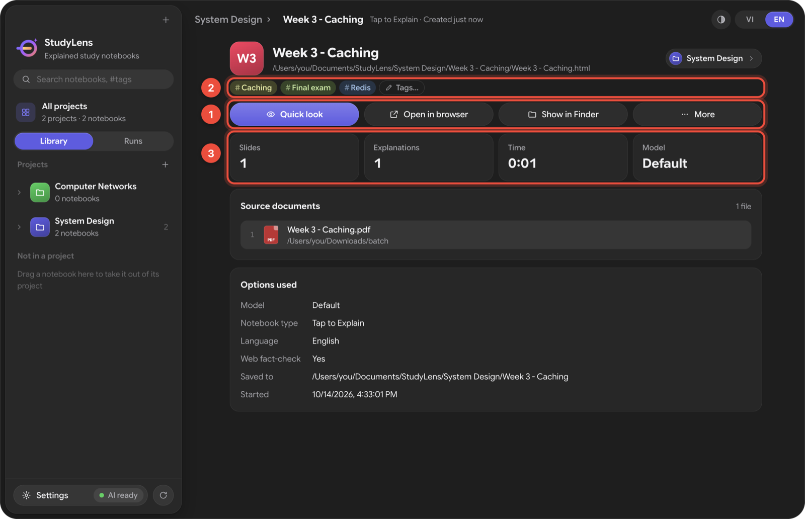

| | |
|---|---|
| **1 · Actions** | Quick look, open in browser, show in Finder / Explorer; **More** has rename, tags, move, run again, view the run, delete. |
| **2 · Tags** | Click **Tags…** to edit. |
| **3 · Stats** | Slides and explanations (Tap to Explain), sections and diagrams (Deep Brief), or modules and items (WBS Map); time and model. |

### 6. Tags and search

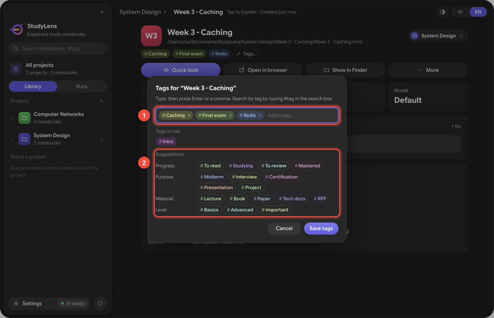

| | |
|---|---|
| **1 · Tags** | Type, then <kbd>Enter</kbd> or a comma. <kbd>Backspace</kbd> removes the last one. Up to 20 per notebook. |
| **2 · Suggestions** | Ready-made tags by progress, purpose, material and level. Click to add. |

Type `#` in the search box to search by tag:

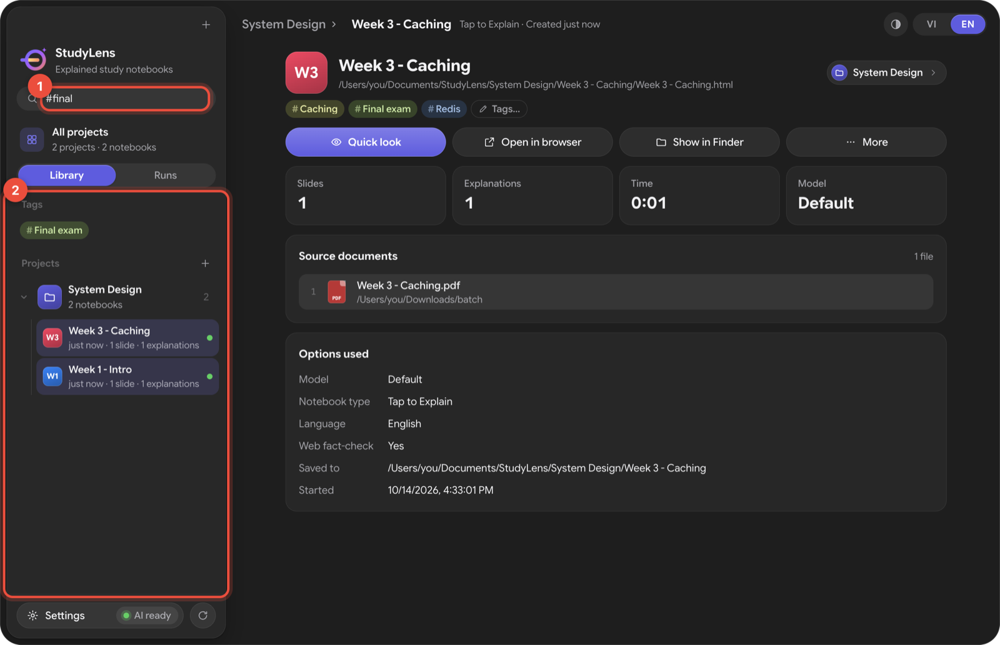

| | |
|---|---|
| **1 · Search** | `#final` matches tags starting with *final*; plain words match titles, file names and tags. Several words must all match. Accents are optional (`on tap` finds *ôn tập*). |
| **2 · Results** | Tags that start with what you typed (click one to finish it), then the matching notebooks by project. |

---

## How it works

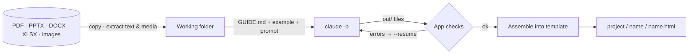

1. **Prepare.** Each run gets its own working folder. PDFs and images are copied as they are; DOCX, PPTX and XLSX have their text extracted (`input-text/`) and their images pulled out (`input-media/`). Excel keeps sheet names and cell columns, skips hidden sheets, and shows numbers as Excel does.
2. **Write.** `claude -p` reads the notebook type's `GUIDE.md` and example, then writes only into `out/`.
3. **Check.** The app validates what came back, and sends any errors to the same session with `--resume` (up to 3 rounds):
   - *Tap to Explain* — every link has its article, ids unique, tags balanced, the required blocks present.
   - *Deep Brief* — structure, balanced tags, no dead anchors, tables wrapped, and every Mermaid diagram actually draws (rendered in a hidden window).
   - *WBS Map* — Claude only says **how to read the sheet** (sheet, rows, columns) and writes the analysis; the app reads **every number from the workbook**, checks that each item is in exactly one module and that totals match the sheet's TOTAL row.
4. **Assemble.** Content goes into the type's template (CSS, navigation, interactivity) and is saved as one `.html` that works offline.

---

## Safety

The AI works on your files unattended, so the limits are set in code:

- Claude runs with a fixed tool list (Read, Write, Edit, Glob, Grep, Task; WebSearch/WebFetch only when **Web fact-check** is on). **Bash is blocked**, permission mode `dontAsk`.
- It writes only inside the run's working folder; the app copies the result out.
- Input documents are treated as data, never as instructions.
- Rich text from the AI is restricted to a small tag allow-list; notebooks have no access to the app (sandboxed preview on a separate origin).
- WBS figures never come from the model — they are read from the spreadsheet and cross-checked.

---

## Releases and self-update

- Installers and the update feed are this repo's **[GitHub Releases](https://github.com/haonguyenstech/studylens/releases)**. Each release also carries fixed-name copies (`StudyLens-mac-arm64.dmg`, `StudyLens-mac-x64.dmg`, `StudyLens-Setup-win-x64.exe`) so the download buttons always point at the newest build.
- To publish: bump `version` in `package.json`, add a `## X.Y.Z` section to `CHANGELOG.md`, run `npm run release` (macOS dmg/zip arm64 + x64, Windows nsis/zip x64; token from `gh auth token`).
- The app checks for updates 4 s after launch and every 6 h (or **Settings → Updates**). macOS: downloads the zip for this chip, verifies its sha256, swaps the `.app` after quitting (rolls back on failure). Windows: silent NSIS install. A running notebook is stopped with its session kept, ready to continue.

---

## Project layout

```
src/main/
├── index.ts          window, IPC, settings, library wiring, quick-look protocol (slpreview://)
├── pipeline.ts       one notebook: prepare → claude -p → check / fix rounds → assemble
├── runs.ts           runs: queue, pause / stop / continue, retry, history
├── library.ts        projects and notebooks on disk (rename, move, tags, delete)
├── convert.ts        PDF/images copied; DOCX/PPTX text + media
├── xlsx.ts           Excel reader (sheets, columns, formulas, merges)
├── notebook.ts       Tap to Explain: check + assemble
├── brief.ts          Deep Brief: check + navigation + assemble
├── diagrams.ts       Mermaid → SVG in a hidden window
├── wbs.ts            WBS Map: read the sheet, check the spec, render
├── claude.ts         find and launch the CLI (stdin prompt, Windows .cmd)
├── guide-shots.ts    renders the Guide's numbered screenshots (dev only)
└── updater.ts        GitHub Releases self-update
src/renderer/         the UI (plain JS + CSS), i18n, fonts
assets/               per notebook type: GUIDE.md (instructions for Claude), template.html, example
  ├── brief/          Deep Brief
  └── wbs/            WBS Map
scripts/              dev, release, tests, fake Claude, CLI runners, WBS test workbook
design/               logo source (logo.svg, render-logo.cjs)
```

App data lives in the Electron user-data folder: `projects.json`, `history.json`, `runs.json`, `settings.json` and the last working folders under `jobs/`.

---

## Credits

- [Claude Code](https://claude.com/claude-code) — writes the notebooks
- [Electron](https://www.electronjs.org/) (MIT) · [JSZip](https://stuk.github.io/jszip/) (MIT/GPLv3) · [Mermaid](https://mermaid.js.org/) (MIT)
- [Google Sans Flex](https://fonts.google.com/) — SIL Open Font License

<div align="center"><sub>© Hao Nguyen · All rights reserved.</sub></div>
